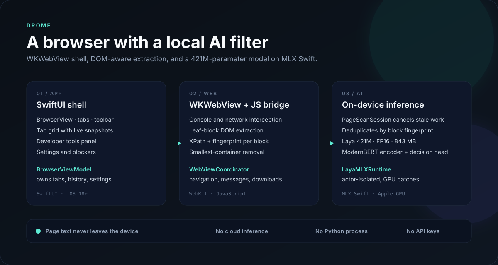

# Drome

**An iOS browser with a fully on-device AI content filter.**

Drome pairs a real WKWebView browser — tabs, developer tools, blockers, downloads — with a native Swift port of a 421M-parameter decision model running on MLX. Page text is classified locally on the Apple GPU. There is no cloud inference, no API key, no Python process, and no Apple Intelligence dependency.

[](https://github.com/ss-pratapIIITB/Drome/actions/workflows/ci.yml)




## Highlights

- **Native MLX model port** — ModernBERT encoder, two-layer decision transformer, marker-token scoring head, prompt construction, and calibrated temperatures implemented in Swift.
- **On-device by construction** — the 843 MB FP16 checkpoint downloads once; inference is local and page text never leaves the phone.
- **DOM-aware removal** — extracts leaf text blocks, so one bad paragraph does not take down the whole article.
- **Cancellation-aware scanning** — queued work is dropped and late results are rejected when the page changes or the tab loses focus.
- **Incremental rescans** — mutation observers and fingerprint checks skip blocks that were already classified, including back/forward restores.
- **Image screening** — visible images are cropped from a WebView snapshot and classified by a bundled int8 NSFW model; flagged media hides with the same reversible mechanism.
- **A real browser around it** — multi-tab browsing, snapshots, network ad/tracker blocking plus cosmetic ad-slot hiding, website blocking, dark mode, custom user agents, downloads, and a resizable developer-tools panel.

## Why this project exists

Most "AI in an app" demos call a remote endpoint. Drome is an exercise in the harder version: shipping a language model inside the app, on hardware you do not control, while keeping the UI responsive.

The interesting engineering is not the prompt. It is the memory budget, the tensor layout, the tokenizer special tokens, the calibration temperatures, the cancellation semantics, and the DOM strategy that turns a classifier's decision into a minimal, reversible visual change.

## Demo

A 90-second recording plan — including the reversible hide, the Laya playground, and the airplane-mode proof — is in [`docs/demo.md`](docs/demo.md). The same document lists the screenshots and GIF the repository should carry.

Performance findings, the fast-path changes, and remaining risks are in [`docs/performance.md`](docs/performance.md). The proposed UI direction is in [`docs/ui-plan.md`](docs/ui-plan.md).

## Install

The app is not on the App Store. Build it from source or sideload a signed copy:

- **[Installation and sideloading guide](docs/install.md)** — Xcode, Sideloadly, and AltStore/SideStore paths, including free-Apple-ID limitations.
- **Unsigned IPA** — every `v*` tag produces an unsigned IPA artifact in GitHub Actions; sign it with your own Apple ID before installing.

Requirements: iOS 18 or later, an Apple-silicon iPhone (iPhone 15 Pro or newer is the practical baseline for the model), and about 1 GB of free storage.

## Architecture

```
DromeApp
└── ContentView (BrowserViewModel)
    ├── BrowserView
    │   ├── AddressBarView
    │   ├── DromeWebView ── WebViewCoordinator
    │   │                    ├── navigation, progress, snapshots
    │   │                    ├── console + network message bridge
    │   │                    ├── downloads
    │   │                    └── AI scan trigger
    │   ├── DeveloperToolsView
    │   └── BottomToolbarView
    ├── TabGridView
    ├── SettingsView
    └── WebsiteBlockerView

AI pipeline (per visible page):
  WebViewCoordinator.didFinish
    → PageScanSession            (cancellation, dedupe, bounded batches)
    → drome-extract.js           (visible leaf blocks, XPath, fingerprint)
    → AIContentFilter            (keyword guard + batched Laya classification)
    → LayaMLXRuntime             (unsafe pass, category only for flagged blocks)
    → drome-bridge.js            (batched labels, reversible hide)
```

See [`docs/laya-mlx-swift.md`](docs/laya-mlx-swift.md) for the model port, runtime requirements, and the fidelity-validation plan.

## How the filter works

1. `drome-extract.js` walks visible block elements, keeps leaf text blocks, drops navigation/footer/code/high-link-density noise, and deduplicates repeated text. Container-sized blocks (> 1200 chars) and UI shells containing form controls are skipped; widget rows (`option` / `menuitem`) hide individually, so a flagged search suggestion never takes the search bar with it. Images and videos with descriptive `alt` / `aria-label` / `title` text become blocks of their own.
2. Qualifying blocks are queued in `PageScanSession` with a stable ID and content fingerprint.
3. A keyword guard handles short blocks and provides a fallback if the model cannot load.
4. Laya evaluates a batch of blocks with the unsafe question; each block is prefixed with page context (title + host) so factual news about energy, markets, conflict, or health is not judged as alarming in isolation. Headlines additionally need ≥ 0.85 confidence (unless the category is adult or self-harm) before being hidden.
5. Labels are applied to the extracted block elements in one DOM pass, so hiding is reversible and never reloads the page.
6. Visible images and video posters are cropped from a WebView snapshot and classified by the bundled NSFW model; flagged media is hidden with the same mechanism.
7. Toggling **Hide Unsafe Content** restores or hides the same elements without rescanning.

## Branch history

The repository keeps both AI implementations so the evolution is visible.

| Ref | What it is |
| --- | --- |
| `main` | Current implementation. Laya 421M decision model running natively on MLX Swift. |
| `apple-foundation-models` | Archived first implementation using Apple Foundation Models (iOS 26), with a keyword fallback. Also tagged `v0.1.0-apple-foundation-models`. |
| `feature/laya-mlx-backend` | Earlier MLX backend integration point, retained for comparison. |
| `claude/app-perf-gemma-eval-9oiqig` | Archived research branch exploring batching and Gemma/LiteRT evaluation. |

The Apple Foundation Models work is not dead code — it is the baseline this project is measured against.

## Build from source

```bash
git clone https://github.com/ss-pratapIIITB/Drome.git
cd Drome
xcodegen generate          # project.yml is the source of truth
open Drome.xcodeproj
```

In Xcode, select the `Drome` target, set your development team and a unique bundle identifier, then run on a device. If you are using a free Apple ID, switch **Code Signing Entitlements** from `Drome/Drome.entitlements` to `Drome/Drome.Sideload.entitlements`; the increased-memory entitlement is not available to personal teams. See [`docs/install.md`](docs/install.md).

To produce an unsigned IPA:

```bash
./scripts/build-ipa.sh
```

## Testing

Two layers, both runnable locally.

**Swift unit and UI tests**

```bash
./scripts/run-tests.sh
```

The suite covers page-scan cancellation and deduplication, JavaScript-injection contracts, and the keyword/fallback path of the content filter. CI builds every pull request and runs the tests on an iOS simulator.

**Removal-quality evaluation (`eval/`)**

A local harness that measures what actually disappears from a page, not just what the classifier said:

- Real mobile pages (BBC article, Verge feed, Al Jazeera article) are captured with an iPhone user agent into `eval/fixtures/mobile/`.
- Synthetic unsafe units (ad urgency, doom finance, gore comment, panic health, explicit media with alt/aria-label text) are cloned into each page's own card/paragraph structure (`eval/fixture_build.mjs`), with ground truth in `fixtures.json`.
- `eval/run_removal_eval.py` extracts blocks with the shipped `drome-extract.js`, resolves each flagged block to its hiding unit, applies the hides, and reports:
  - `removedAll` — every unsafe fragment is hidden,
  - `noCollateral` — no benign page text disappeared,
  - `cascade-covered` — hides that removed more than the flagged leaf.

`--skip-laya` uses hand labels instead of the model, separating extraction/hiding bugs from classifier verdicts; the full run drives the real Laya MLX classifier on a saved fixture. Reports land in `eval/reports/` (gitignored), and `node eval/extract_blocks.mjs` re-runs a single page. See [`eval/README.md`](eval/README.md) for the fixture pipeline, label format, and command reference.

## Performance

- 421M parameters, FP16, 842,609,225-byte checkpoint.
- Model load and inference run on the Apple GPU through MLX.
- Linear layers are quantized to int8 at load (group 64); embeddings and norms stay FP16. Resident weights drop from ~843 MB to ~460 MB. Toggle in Settings → Laya MLX (applies on relaunch).
- The MLX boundary, why an engine rewrite is not a useful lever, and the tuning roadmap are in [`docs/optimization.md`](docs/optimization.md).
- Latency, peak memory, and thermal behavior vary by device; measure on your target hardware before making claims. `docs/laya-mlx-swift.md` lists the metrics to capture.

## Privacy and limitations

- After the first model download, page text is classified on-device and is never uploaded by the app.
- The model is a research artifact, not a clinical or child-safety guarantee. False positives and false negatives are expected.
- The filter is on by default and can be disabled in Settings → Privacy.
- Only visible content is scanned: qualifying text blocks, images and videos with descriptive `alt` / `aria-label` / `title` text, and visible image pixels through the bundled NSFW classifier. Canvas and media without descriptive text are only covered by the image pass, which sees rendered pixels.
- Image screening is a general classifier (int8 ViT, ~86 MB), not a guarantee: it can miss ambiguous images and occasionally flag benign photos (swimwear, art, fitness). Its threshold lives in `ImageSafetyFilter.swift`.
- The Laya MLX checkpoint is downloaded from Hugging Face at runtime and its metadata lists Apache-2.0. Review the model card before redistribution.

## License

Apache-2.0. See [`LICENSE`](LICENSE) and [`NOTICE`](NOTICE).

Drome builds on [MLX Swift](https://github.com/ml-explore/mlx-swift), [swift-transformers](https://github.com/huggingface/swift-transformers), and the [Laya](https://huggingface.co/aac6fef/laya-mlx) model.
